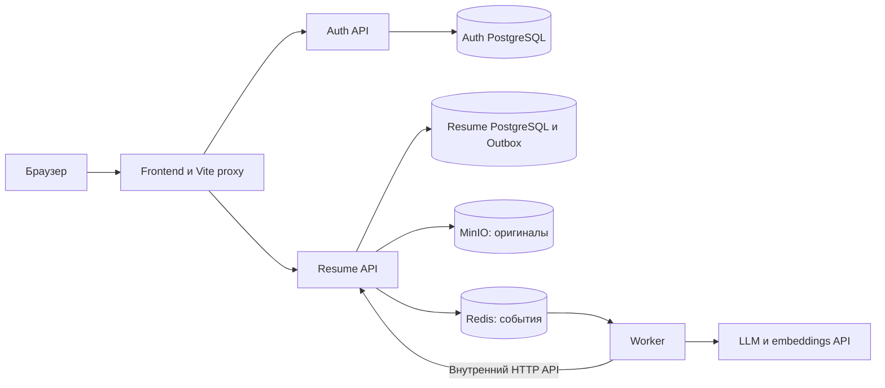
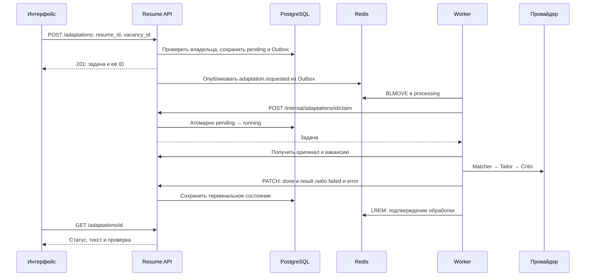
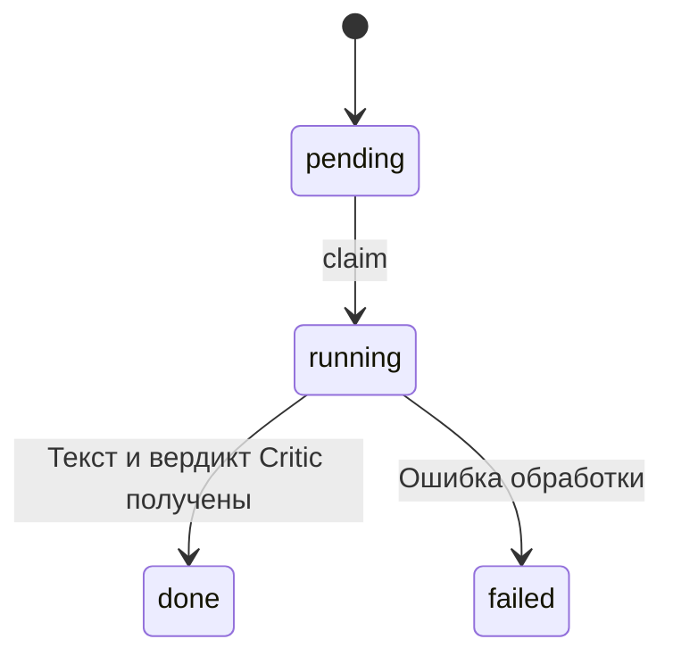

# Архитектура

[Главная документация](../README.md) · [API](api.md)

## Сервисы

Auth отвечает за пользователей и JWT. Resume хранит метаданные оригиналов, вакансии, задачи адаптации и Outbox. Worker читает события Redis, получает документы через внутренний API и сохраняет результат через него же. У worker нет прямого доступа к PostgreSQL и MinIO.

Для браузера Vite предоставляет общий origin и проксирует `/auth` в auth, а `/resumes`, `/vacancies`, `/adaptations` — в resume. В текущем Compose frontend работает как dev server. При публикации собранного `dist` потребуется отдельно настроить proxy API и возврат `index.html` для UI-маршрутов.

## Хранение

| Данные | Место | Представление |
| --- | --- | --- |
| Пользователь и пароль | Auth PostgreSQL | Пользователь, хеш пароля, признаки активности и сотрудника |
| Исходный файл | MinIO | Оригинальные байты PDF/DOCX |
| Резюме | Resume PostgreSQL, `resumes` | ID, владелец, внутренний URL файла, embedding, время создания |
| Вакансия | Resume PostgreSQL, `vacancies` | ID, владелец, полный текст, embedding |
| Адаптация | Resume PostgreSQL, `adaptations` | Ссылки на оригинал/вакансию, статус, JSON результата, ошибка, время создания |
| Событие до публикации | Resume PostgreSQL, `outbox_events` | JSON события и время создания |
| Событие после публикации | Redis | Основная и processing-очередь |
| Токены браузера | `sessionStorage` | Access и refresh token |
| Черновик и список известных версий | Память вкладки | Сбрасываются при перезагрузке, явном выходе и смене аккаунта |

Embeddings записываются как JSONB. Образ `pgvector/pgvector:pg16` сам по себе не означает, что приложение выполняет векторный поиск: в текущей адаптации векторы не используются.

Извлечённый текст оригинала не сохраняется как структурированный профиль. При адаптации worker получает файл и извлекает полный текст заново. Вакансия остаётся одним текстовым документом.

## Загрузка оригинала и вакансии

1. Resume API проверяет JWT и определяет владельца из него.
2. Для оригинала проверяется формат файла, затем он сохраняется в MinIO. Для вакансии принимается полный текст.
3. Метаданные ресурса и событие `resume.uploaded` или `vacancy.uploaded` записываются в одной транзакции PostgreSQL.
4. Outbox dispatcher публикует событие в Redis, затем удаляет его из Outbox.
5. Worker получает оригинал через внутренний API, извлекает текст или читает текст вакансии, запрашивает embedding и сохраняет его через PATCH внутреннего API.

MinIO и PostgreSQL не участвуют в общей транзакции. При ошибке записи метаданных сервис пытается удалить уже загруженный файл; это компенсация, а не атомарная операция двух хранилищ.

PDF и DOCX проверяются по содержимому, а не только по расширению. Зашифрованный PDF отклоняется. OCR отсутствует: скан без текстового слоя не превращается в текст. Успешная загрузка файла не гарантирует успешное извлечение текста worker.

## Создание адаптации

POST проверяет принадлежность обоих исходников пользователю. Нельзя создать задачу из чужого резюме или вакансии. Отдельные запросы с одинаковыми `resume_id` и `vacancy_id` создают отдельные записи: идемпотентного ключа создания нет.

Задача доступна по ID сразу после сохранения. Интерфейс опрашивает её раз в две секунды и прекращает опрос при `done`, `failed` или уходе со страницы.

### Цепочка LLM

`ResumeAdaptationService` последовательно вызывает три агента:

| Агент | Вход | Назначение |
| --- | --- | --- |
| Matcher | Полные тексты оригинала и вакансии | Сопоставить подтверждённый опыт с требованиями |
| Tailor | Оригинал, вакансия и результат Matcher | Подготовить текст резюме с нужными акцентами, сохранив факты |
| Critic | Оригинал, вакансия и адаптированный текст | Найти неподтверждённые факты и нарушения сохранности исходных сведений |

Parser и Writer в репозитории являются заготовками и в этой цепочке не участвуют. Автоматического повторного Tailor после замечаний Critic нет.

Worker использует Chat Completions с `response_format={"type":"json_object"}`. JSON-ответы дополнительно проверяются схемами приложения. Модель должна поддерживать этот интерфейс и JSON mode. Модель и базовый URL задаются конфигурацией worker; таймаут HTTP сейчас фиксирован в коде на 20 секунд.

Для embeddings провайдер получает полный извлечённый текст. При адаптации он получает полные тексты резюме и вакансии, а Critic — также новую версию. Минимизация документов до отдельных фрагментов не реализована.

### Состояния задачи

| Статус | `result` | `error` | Значение |
| --- | --- | --- | --- |
| `pending` | `null` | `null` | Задача сохранена, worker ещё не забрал её |
| `running` | `null` | `null` | Worker успешно выполнил claim |
| `done` | Текст и `review` | `null` | Цепочка закончена, независимо от одобрения Critic |
| `failed` | `null` | Название класса исключения | Техническая ошибка извлечения, LLM или обработки |

`review.passed=true` требует пустой список `issues`; `false` — непустой список содержательных замечаний. Отклонение Critic не является технической ошибкой. Пользователь видит текст вместе с замечаниями.

Claim реализован условным обновлением `pending → running`. Только один конкурентный worker может получить задачу. Повторный claim существующей `running`, `done` или `failed` возвращает `null`. Изменить терминальное состояние через finish нельзя.

## Доставка событий и сбои

События имеют `event_type` и `data` с ID ресурса и владельца; тексты документов в Redis не передаются. Публикатор добавляет их в конец очереди, worker переносит с начала очереди в processing через `BLMOVE`.

| Событие | Данные |
| --- | --- |
| `resume.uploaded` | `resume_id`, `user_id` |
| `vacancy.uploaded` | `vacancy_id`, `user_id` |
| `adaptation.requested` | `adaptation_id`, `user_id` |

Основная очередь по умолчанию — `embedding_tasks`, processing — `embedding_tasks:processing`. Один процесс worker обрабатывает события последовательно. Задачи embeddings и адаптации используют общую очередь.

Outbox dispatcher блокирует выбранную запись через `FOR UPDATE SKIP LOCKED`. Если Redis недоступен, запись остаётся в PostgreSQL и публикация повторяется. Если публикация состоялась, но её транзакция не завершилась, событие может прийти повторно.

Worker удаляет сообщение из processing только после сохранения результата/ошибки или пропуска дубликата. У адаптаций claim защищает от повторного вызова LLM для уже выполняемой или завершённой задачи. Это не гарантия exactly-once для всей системы.

При ошибке claim/сохранения или аварии процесса сообщение может остаться в processing, а задача — в `running`. Автоматического переноса обратно, DLQ и восстановления состояния сейчас нет. Простое повторное помещение события `running` в очередь не перезапустит LLM: claim вернёт `null`. Перед ручным восстановлением нужно проверить состояние БД, processing и наличие ещё работающего процесса. Документация не предлагает массово очищать очередь или сбрасывать статусы.

Остановка worker во время вызова провайдера тоже может оставить `running`; новые задачи лучше не отправлять перед плановым обновлением, а текущим дать завершиться.

## Авторизация и границы доступа

- Auth выдаёт access/refresh JWT. Auth и resume используют общий `SECRET_KEY` и HS256. Сроки access 15 минут и refresh 30 дней заданы в коде, env-переменные этих сроков не читаются.
- Публичный resume API получает `user_id` из проверенного access token и ограничивает доступ владельцем. Отсутствующие и чужие ресурсы возвращают 404.
- Список и карточка пользователей требуют роли сотрудника на сервере. Интерфейс проверяет `is_staff` из `/auth/me`, скрывает навигацию и не монтирует закрытые страницы для обычного пользователя.
- Worker использует отдельный `X-Worker-Token` и передаёт `user_id` в query. Внутренний API проверяет соответствие владельца ресурсу; браузер эти методы не вызывает.
- Файлы скачиваются авторизованным запросом к resume API. Внутренний URL MinIO не используется как пользовательская ссылка, JWT не помещается в URL.
- Браузер объединяет конкурентные 401 в один refresh и повторяет исходный запрос не более одного раза. Поздние ответы после выхода или смены аккаунта отбрасываются.
- Неопределённый результат POST при сетевой ошибке, таймауте или 5xx не повторяется автоматически: сервер мог сохранить запись.

## Где менять реализацию

| Задача | Основные файлы |
| --- | --- |
| Публичные методы документов и адаптаций | [resume API](../backend/resume/app/api/resume.py), [vacancy API](../backend/resume/app/api/vacancy.py), [adaptation API](../backend/resume/app/api/adaptation.py) |
| Контракты результата | [API schemas](../backend/resume/app/schemas/adaptation.py), [worker schemas](../backend/worker/app/schemas/resume_adaptation.py) |
| Переходы состояний и транзакции | [AdaptationRepository](../backend/resume/app/repositories/adaptation.py) |
| Публикация событий | [OutboxDispatcher](../backend/resume/app/messaging/outbox_dispatcher.py) |
| Получение и подтверждение события | [RedisConsumer](../backend/worker/app/messaging/redis_consumer.py) |
| Обработка задачи | [AdaptationTaskService](../backend/worker/app/services/adaptation_task.py) |
| Последовательность агентов | [ResumeAdaptationService](../backend/worker/app/services/resume_adaptation.py) |
| Инструкции LLM | [Matcher](../backend/worker/app/prompts/matcher.py), [Tailor](../backend/worker/app/prompts/tailor.py), [Critic](../backend/worker/app/prompts/critic.py) |
| Рабочее пространство и результат | [WorkspacePage](../frontend/src/pages/WorkspacePage.tsx), [AdaptationPage](../frontend/src/pages/AdaptationPage.tsx) |
| Браузерная сессия и запросы | [HTTP client](../frontend/src/api/client.ts), [drafts](../frontend/src/app/drafts.ts) |

При изменении схемы хранения нужна миграция Alembic, при изменении ответа — согласованное обновление backend-схем, frontend-типов и контрактных тестов. Проверки с подставной LLM подтверждают последовательность и валидацию; качество формулировок проверяется отдельно на реальных прогонах.
